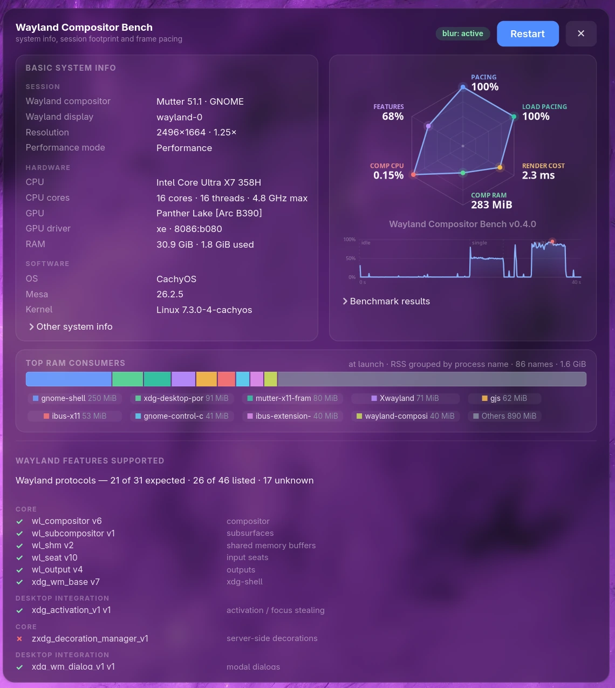

# wayland-compositor-bench

[](https://github.com/grigio/wayland-compositor-bench/actions/workflows/ci.yml)
[](LICENSE)

Measure the Wayland session you are logged into: how much memory and CPU the
compositor costs at rest, what it costs per presented frame, and how much power
the machine draws while it sits there. One Rust binary, no scripts, no Python.



Share your *Wayland Compositor* benchmark online with the hashtag **#wcbench**.

## Highlights

- **The real session, not a sandbox.** It measures the compositor you are
  actually running, with your apps, portals and configuration.
- **Costs are attributed.** Compositor CPU, RAM, GPU time and wakeups are
  separated from the benchmark client and from the rest of the session. A
  compositor that carries its own shell (GNOME) and one that relies on a separate
  panel (labwc + Noctalia) are reported as **core** and **stack**, so the same
  desktop is not compared with a bare compositor. Power is sampled for the whole
  machine.
- **Claims come with evidence.** Every run carries a confidence level, and
  `--compare` refuses to call a difference smaller than the observed noise or to
  declare a winner from fewer than three runs. `--profile reference` removes the
  session's own blur and refresh rate from the render comparison.
- **Raw data stays raw.** The JSON keeps the 100 ms CPU timeline, phase marks,
  protocol versions and every check behind the confidence.

<details>
<summary>Contents</summary>

- [Install](#install)
- [Quick start](#quick-start)
- [The window](#the-window)
- [Commands and options](#commands-and-options)
- [What it measures](#what-it-measures)
- [Reading the numbers](#reading-the-numbers)
- [Making runs comparable](#making-runs-comparable)
- [Power readings](#power-readings)
- [Troubleshooting](#troubleshooting)
- [What this does not measure](#what-this-does-not-measure)
- [Development](#development)
- [Documentation](#documentation)
- [License](#license)
- [Donations](#donations)

</details>

## Install

Runs on Linux inside a Wayland session; there is no X11 mode. Session-wide
figures need cgroup v2, and power needs RAPL or a battery — `--check` reports
anything this machine cannot provide before you measure.

### Released packages

[Tagged releases](https://github.com/grigio/wayland-compositor-bench/releases)
include the Linux binary, an Arch package, a Debian package, the source tarball
and `SHA256SUMS`. Download the one for your distro, then:

```bash
sudo pacman -U wayland-compositor-bench-*.pkg.tar.zst     # Arch
sudo apt install ./wayland-compositor-bench_*_amd64.deb   # Debian / Ubuntu
```

Both packages install `/usr/bin/wayland-compositor-bench`, a `.desktop` launcher
and a hicolor icon, so the tool also appears in the application menu. The Debian
package is built on Debian 13 (GTK 4.18) so the dependency floor is honest; the
Arch package is built by `PKGBUILD` in the repository root.

### From source

To build you need Rust 1.92 or newer and GTK 4.16+ development headers
(`backdrop-filter` is used by the window CSS); to run the tool you need a
Wayland session:

```bash
# Arch
sudo pacman -S --needed rust gtk4 pkgconf wayland

# Debian / Ubuntu
sudo apt install build-essential pkg-config libgtk-4-dev libwayland-dev

git clone https://github.com/grigio/wayland-compositor-bench
cd wayland-compositor-bench
cargo build --release --locked
```

The binary is `target/release/wayland-compositor-bench`; install it anywhere on
your `PATH`.

## Quick start

```bash
wayland-compositor-bench --check          # can this session be measured?
wayland-compositor-bench                  # window, press Start
wayland-compositor-bench --run --json     # measure, save the result, exit
```

If you built from the checkout, use `./target/release/wayland-compositor-bench`
instead.

The `blur:` chip next to Start reports whether the compositor advertises
`ext-background-effect-v1` and doubles as a switch: click it to drop the
translucent, blurred window background for a plain opaque one. Blur is real
compositor work, so the switch makes runs comparable between compositors that
blur and ones that do not.

`--run` measures as soon as the window is up and **exits when done**, so it can
sit in a script. Add `--json` to save the run: results land in
`$XDG_STATE_HOME/wayland-compositor-bench/results/` (`~/.local/state/...` by
default), or at `--json FILE`. The command exits non-zero if the JSON cannot be
written. The label defaults to the desktop the running compositor belongs to
(`GNOME`, `labwc`, …), keeping a session flavour when the environment agrees
with the compositor (`ubuntu:GNOME` becomes `ubuntu-gnome`); use `--label` to
override it.

Log out, log into the next compositor, run it again. Do **three runs per
compositor**: the difference between identical runs is usually bigger than the
one you are chasing.

## The window

- **Live system info:** session identity, compositor version, hardware, power
  profile and current CPU/RAM/GPU counters.
- **Six-axis radar:** pacing on one surface and under load, render cost at a
  common 60 Hz panel, stack RAM and idle CPU, and protocol coverage, each relative to
  a fixed reference rather than to this machine. The three cost axes are
  log-scaled, so 2 % and 8 % of a core stay visibly apart instead of both
  hugging the ring. Every axis is drawn further out is better, so the cost axes
  are inverted and print the raw number with a `↓` marker (lower is better);
  pacing and features carry `↑`. Hover a label for what the axis plots and which
  direction is better.
- **Pre-run access check:** before the first run the placeholder lists any
  metric this machine cannot provide — cgroup v1 or a missing session scope,
  unreadable RAPL, a `hidepid` `/proc`, a missing `schedstat` or PSI — with the
  path and the fix. A green tick says the check passed and every source is
  readable; a red cross names the ones that are not. `--check` prints the same
  probe in more detail.
- **CPU timeline:** the session CPU during the run, with phase marks, so you can
  see *when* it got busy instead of only how busy it got.
- **`TOP RAM CONSUMERS`:** a snapshot of the machine's memory when the window
  opened, grouped by process name.
- **`WAYLAND FEATURES SUPPORTED`:** every registry global with its version,
  grouped by tier.

## Commands and options

```bash
wayland-compositor-bench --report              # medians of saved runs
wayland-compositor-bench --report ~/runs/labwc # a directory, files, or labels
wayland-compositor-bench --compare labwc gnome # side by side, with a noise floor
wayland-compositor-bench --compare labwc gnome ~/runs
```

With no path, `--report` reads the XDG results directory **and** `./results`, so
runs made from the repository keep working. Paths may be directories, JSON files
or label substrings.

`--compare` accounts for the observed run-to-run spread and refuses to call a
difference smaller than the noise. With fewer than three runs per label it says
`anecdotal` instead of inventing a winner, and `--strict` turns any incomparable
pair (different display, blur, stack style, profile or power state) into a
non-zero exit. `--check` exits `2` when the session is measurable only with
caveats, so a script can gate on it.

| option | default | what it does |
|---|---|---|
| `--run` | off | start measuring as soon as the window is up |
| `--json [FILE]` | auto file | write the finished run; implies `--run` |
| `--label NAME` | running desktop | name the run |
| `--idle S` | 20 | idle sampling window |
| `--frames S` | 6 (10 with `reference`) | length of each frame test |
| `--windows N` | 6 | extra animated toplevels |
| `--settle S` | 45 | maximum wait for the session to go quiet |
| `--stack auto\|none\|NAME,…` | `auto` | shell/panel/notification processes counted in the stack |
| `--profile native\|reference` | `native` | `reference` turns blur off, targets 60 Hz and runs a 10 s frame test |
| `--target-hz HZ` | 0 (native) | throttle the benchmark client to a fixed rate |
| `--strict` | off | make `--compare` fail on incomparable runs |

The stack is the compositor plus the separate shell/panel/notification
processes listed by `--stack` (Waybar, Noctalia, Quickshell, SwayNC, …). With
`auto`, the tool looks for a known list in the measured session scope: the
login session cgroup plus the systemd user manager when the desktop spans both.
That matters because greetd can start the compositor in `session-N.scope` while
`noctalia.service`, the portals and other user units live under
`user@UID.service`; measuring only the login scope would miss the panel
entirely. `none` reports the compositor core only. The JSON records the
selector, every process it added and whether the desktop is `integrated`
(GNOME, shell inside the compositor) or `modular` (separate panel), so a
comparison cannot silently mix the two scopes.

Environment variables: `WG_BENCH_AUTORUN=1` (same as `--run`),
`WG_BENCH_PRINT=1` (echo result rows to stdout), `WG_BENCH_NO_SUDO=1` (never use
`sudo -n` for RAPL). See `--help` for the rest.

## What it measures

| phase | what you get |
|---|---|
| **idle** | session working set, compositor **core** PSS and CPU, **stack** PSS/CPU with the declared shell, attributed unrelated CPU, wakeups/s for both scopes, package and battery power |
| **toplevels** | the same session with N extra windows open: signed working-set delta against a double-sampled baseline, per-window only when the delta is valid, GPU memory held by client and compositor, and post-close drift |
| **frames (single)** | one animated surface: fps, panel pacing, cadence, p50/p95/max interval, missed frames against both the cadence and the panel, compositor CPU/frame and CPU@60Hz %, GPU/frame (compositor + client), app CPU/frame, package and battery power for the test |
| **frames (multi)** | the same surface plus N animated toplevels — what a real desktop does all day |
| **protocols** | every `wl_registry` global with its version, grouped by tier; the whole snapshot is saved in the run JSON, including stale versions |
| **peaks** | 25 ms sampler for RAM and CPU spikes during the run; the 100 ms CPU timeline and phase marks are saved in the JSON |

All measurements come from `/proc`, the session's cgroup v2 and sysfs. The exact
source of each figure, the session/cgroup resolution rules and the measurement
window ordering are documented in [DESIGN.md](DESIGN.md#measurement-model).

## Reading the numbers

- `comp ms/frame` is the honest "how heavy is this compositor's render path"
  number: CPU time per presented frame, independent of GPU speed. Lower is
  leaner. `CPU@60Hz %` scales the measured CPU from the panel refresh to 60 Hz,
  so a 120 Hz panel cannot make the same work look cheaper than a 60 Hz one.
  It scales total CPU rather than CPU per presented frame because a throttled
  client can leave the compositor doing per-vblank work; `--profile reference`
  keeps the client workload common as well.
- `app ms/frame` tells you whether the benchmark itself was the bottleneck. If
  it is close to `comp ms/frame`, the run measured a slow client as much as a
  slow compositor.
- `panel %` is delivered frames as a share of the panel refresh: a deliberate
  60 fps on a 120 Hz panel is 50 %, not 100 %. `drop/panel` counts missed frames
  against the panel period. `fps` next to `cadence` still describes the rate the
  compositor settled into, which is useful for native-rate runs but flatters a
  throttled one.
- `RAM` is the working set (`anon + shmem`), so a desktop that read 2 GiB of
  files does not look worse than one that read nothing.
- `psys` is the whole SoC (CPU + iGPU + fabric) — the best battery proxy. `pkg`
  is the CPU package alone, `bat` is what the battery reports.
- `core` is the compositor process tree; `stack` adds the declared shell/panel
  processes. A GNOME run reports them as one integrated desktop; a labwc +
  Noctalia run reports the panel separately. Compare core with core or stack
  with stack, never one against the other.
- `unrel CPU` (unrelated) is session CPU outside the stack and this tool. A
  `quiet cpu` check fails above 5 % and names the top offenders from the same
  idle window and the same exclusion set, so a shell is not mistaken for noise
  and an unexplained idle figure comes with a diagnosis. A process that started
  during the window is not charged its whole lifetime CPU.
- `wakeups/s` is process-wide: it sums every thread's context switches, not just
  the thread-group leader.
- GPU time is reported for the compositor and the benchmark client separately;
  the report shows both columns and the JSON keeps the two components.
- Extra-toplevel memory keeps the signed delta. `per-window` is left empty when
  the delta is negative or the baseline moved, and the JSON labels the method
  `same-process GTK toplevels` because the extra windows share this process's
  GTK buffer pool.
- Coverage counts only the **Core / Rendering / Desktop** tiers. wlroots-only
  and optional protocols are listed with their versions but not scored;
  otherwise the number rewards a design choice.
- There is no single score. Any scalar over arbitrary weights can be quoted
  without its trade-offs; read the axes.

Every run carries a `confidence` of `high`, `medium` or `low`, derived from
checks stored in the JSON: session cgroup resolved, compositor resolved by socket,
presentation feedback, display refresh known, session clean, quiet CPU. When
`--json` writes a run it also stores the 100 ms CPU timeline and its phase marks,
so spike patterns survive the medians. `--report` prints the failing checks and
warns when a label mixes blur states or other incomparable context. The check
list and confidence rules are in
[DESIGN.md](DESIGN.md#checks-and-confidence).

## Making runs comparable

1. **Same output, refresh and scale.** Idle power and RAM scale with pixels and
   Hz; 60 vs 120 Hz is the largest single variable on this panel. The display
   block is in every JSON, and `--report`/`--compare` warn when they differ.
2. **Same power state.** On battery, discharging, same platform profile and
   brightness. Plugging in changes both the drain and the thermals.
3. **Clean session.** The tool flags processes over 150 MiB and CPU outside the
   stack and itself; close them. Lazy portals arrive seconds after login,
   so the run waits for the session to go quiet instead of sleeping a fixed
   time.
4. **Same blur state.** The chip is recorded in every JSON; `--report` warns
   when a label mixes blur on and off, because blur is real compositor work.
   `--profile reference` starts with blur off and a 60 Hz target so the render
   comparison does not measure your configuration.
5. **Same stack scope.** labwc is a WM; GNOME is a WM plus a shell, search,
   notifications and portals. Measure bare sessions (`--stack none`) and full
   desktops (`--stack auto`), and say which one you are reporting. `--compare`
   warns when one side is `integrated` and the other `modular`.
6. **Three runs, and use `--compare`.** It accounts for the observed spread and
   refuses to call a difference smaller than the noise; fewer than three runs
   per label is labelled `anecdotal`.

The benchmark's own window is a real client: it counts toward the compositor's
cost. That is intentional — it is the only way to animate something the
compositor must composite.

## Power readings

RAPL `energy_uj` is `0400 root` on most distros. Power is optional and no
measurement requires root: when the file is not world-readable the tool tries a
non-interactive `sudo -n cat` for each power sample and never prompts. Set
`WG_BENCH_NO_SUDO=1` to forbid that. Readings are taken outside the CPU
measurement windows, so the fork cannot be charged to the session. To read it
without sudo:

```bash
# /etc/udev/rules.d/99-rapl-read.rules
SUBSYSTEM=="powercap", ACTION=="add", RUN+="chmod a+r %S%p/energy_uj"
```

```bash
sudo udevadm control --reload && sudo udevadm trigger --subsystem-match=powercap
```

`--check` says whether RAPL is readable. Without it, power columns are `null`,
not zero.

## Troubleshooting

- Run `--check` first: it prints the session, compositor, display, power and
  system details, plus the heavy processes that would make a run noisy.
- Exit code `0` means measurable; exit code `2` means measurable with caveats
  (for example unreadable RAPL or a busy session). The reasons are printed.
- `--report` prints the failing checks behind a `medium` or `low` confidence,
  and warns when saved runs differ in display, config, blur state or session
  scope.
- If `WAYLAND_DISPLAY` is unset, start the tool from inside a Wayland session.
- If power is `null`, follow [Power readings](#power-readings).

## What this does not measure

- **Input-to-photon latency.** Needs a photodiode or evdev injection plus
  capture; not a property of a compositor alone.
- **GPU utilisation percentage.** Drivers do not expose it. The per-client
  counters give GPU time for the compositor and its clients — an estimate, and
  `null` on drivers that expose neither cycles nor engine times.
- **Video, WebGL, games.** Built-in workloads only: a Cairo strip and animated
  toplevels. A fullscreen GL client you can run yourself is not measured either
  — the tool would have no presentation feedback for it.
- **HDR, colour accuracy, VRR behaviour, multi-monitor.** First connected output
  only.
- **XWayland** clients and the cost of the X server.
- **Power on machines with no battery and no readable RAPL.**

## Development

```bash
cargo fmt --check
cargo clippy --all-targets --locked -- -D warnings
cargo test --locked
cargo build --release --locked
```

The tests run headless. `makepkg -si` builds the Arch package from the checkout;
`packaging/build-deb.sh` builds the Debian package on Debian 13. Issues and pull
requests are welcome.

## Documentation

- [DESIGN.md](DESIGN.md) — architecture, measurement model, JSON schema,
  reporting statistics, tests and release tooling.
- [CHANGELOG.md](CHANGELOG.md) — release history.

## License

GPL-3.0-only. See [LICENSE](LICENSE).

## Donations

If you find this project helpful, please consider making a donation to support
its development.

- **Monero**: `88LyqYXn4LdCVDtPWKuton9hJwbo8ZduNEGuARHGdeSJ79BBYWGpMQR8VGWxGDKtTLLM6E9MJm8RvW9VMUgCcSXu19L9FSv`
- **Bitcoin**: `bc1q6mh77hfv8x8pa0clzskw6ndysujmr78j6se025`
